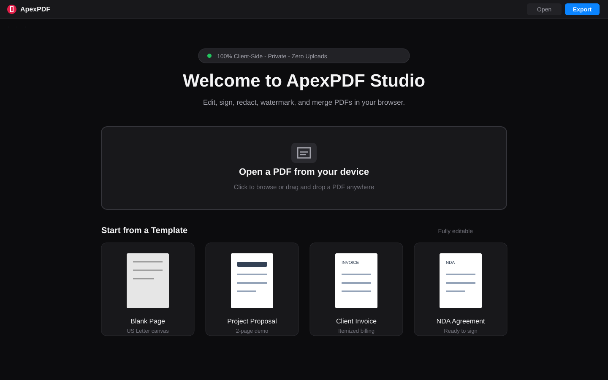
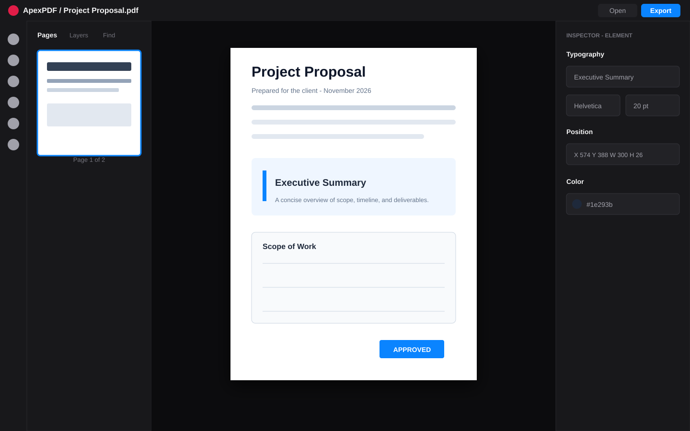
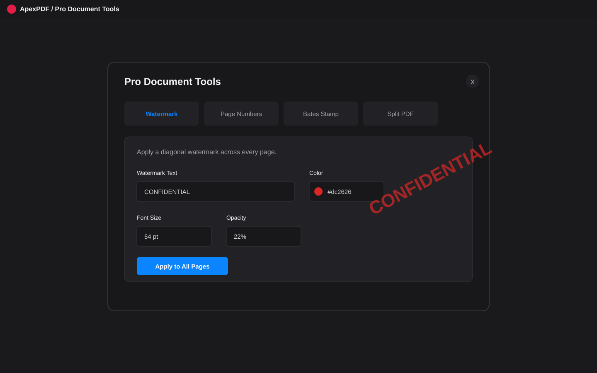

# ApexPDF Studio

ApexPDF Studio is a private, browser-based PDF editing workspace. It uses PDF.js and pdf-lib to open, edit, sign, annotate, redact, organize, and export PDF documents entirely in the browser. Files are not uploaded to a server.

## Features

- Open existing PDF files and blank documents
- Edit, move, resize, rotate, duplicate, lock, and align elements
- Edit text directly on the page or through the inspector
- Move and select replaced existing-text blocks on the page
- Resize and reposition existing-text replacements
- Add text, freehand drawings, highlights, shapes, stamps, checkboxes, and notes
- Add typed or drawn e-signatures
- Apply permanent redactions
- Merge PDFs, reorder or split pages, and rotate pages
- Add watermarks, Bates numbers, and page numbers
- Add page images
- Rename documents and edit PDF metadata
- Extract text and export a `.txt` file
- Undo and redo changes
- Switch between light and dark themes
- Export the finished document as a PDF

## Project Structure

```text
pdf-helper/
|-- index.html      # Page structure and external library/CDN imports
|-- script.js       # ApexPDF Studio application logic
|-- style.css       # Theme, layout, controls, and editor styles
|-- README.md
`-- docs/
    `-- screenshots/ # Optional product screenshots
```

## Requirements

- A modern browser such as Chrome, Edge, or Firefox
- Internet access for the external Tailwind CSS, PDF.js, pdf-lib, and Google Fonts assets
- A local HTTP server for development

## Run Locally

Do not open the project only as a `file://` URL if the browser blocks module or worker resources. Serve the folder through HTTP.

### Windows PowerShell

```powershell
cd "C:\Users\USER\my projects\pdf-helper"
py -m http.server 8080
```

Then open:

```text
http://localhost:8080
```

Stop the server with `Ctrl+C`.

### Visual Studio Code

1. Open the project folder in VS Code.
2. Install the **Live Server** extension.
3. Right-click `index.html`.
4. Select **Open with Live Server**.

## Basic Usage

1. Open a PDF with **Open**, or create a blank PDF with **New**.
2. Select a tool from the left toolbar.
3. Click or drag on the page to add content.
4. Select an element to move or resize it.
5. Use the right inspector to change text, fonts, colors, alignment, rotation, opacity, and size.
6. Use Undo or Redo to change recent edits.
7. Select **Export** to download the edited PDF.

## Keyboard Shortcuts

| Shortcut | Action |
|---|---|
| `Ctrl/Cmd+Z` | Undo |
| `Ctrl/Cmd+Y` | Redo |
| `Ctrl/Cmd+S` | Export PDF |
| `Ctrl/Cmd+D` | Duplicate selected element |
| `Ctrl/Cmd+C` | Copy selected element |
| `Ctrl/Cmd+V` | Paste selected element |
| `Delete` / `Backspace` | Delete selected element(s) |
| `Arrow keys` | Nudge selected elements |
| `Shift+Arrow` | Nudge by 10 points |
| `G` | Toggle snap grid |
| `V` | Select tool |
| `E` | Edit existing text |
| `T` | Add text |
| `D` | Draw |
| `H` | Highlight |
| `R` | Shape |
| `M` | Stamp |
| `K` | Checkbox |
| `X` | Redact |
| `C` | Note |

## Privacy

PDF processing happens in the browser. The application does not contain an upload API or server-side document storage. The browser still loads page assets and PDF.js libraries from their configured CDNs.

## Screenshots

Place project screenshots in `docs/screenshots/` and reference them from this section:

```text
docs/screenshots/home.png
docs/screenshots/editor.png
docs/screenshots/pro-tools.png
```

Recommended screenshot workflow:

1. Start the local server with `py -m http.server 8080`.
2. Open `http://localhost:8080` in a browser.
3. Capture the welcome screen at 1440 x 900.
4. Open a sample PDF and capture the editor.
5. Open an inspector or Pro Tools modal and capture it separately.
6. Save PNG files in `docs/screenshots/`.
7. Replace the placeholders below with the real Markdown image links.

### Welcome Screen



### PDF Editor



### Pro Document Tools


